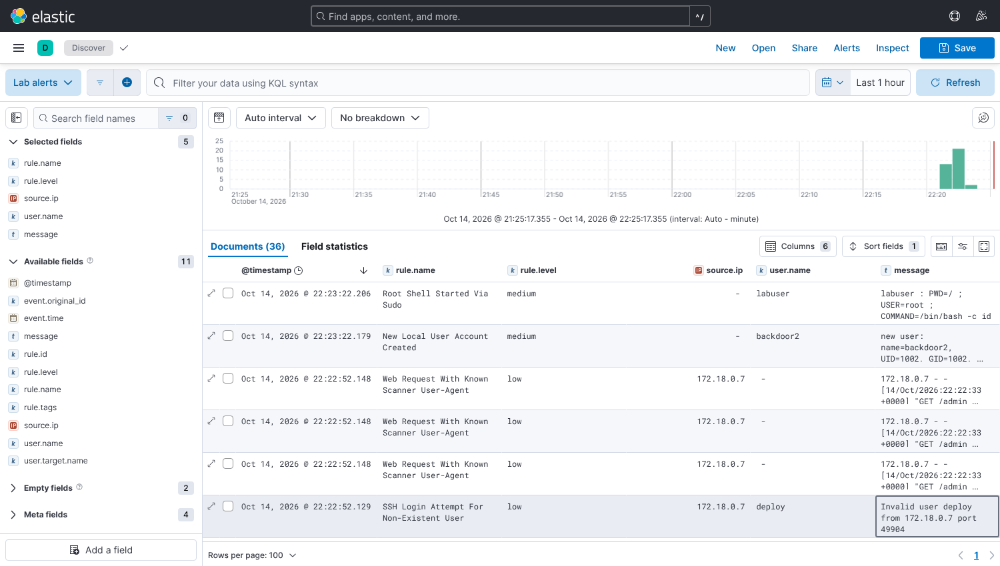
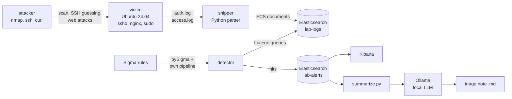

# Home Security Lab

A small, self-contained detection lab that runs on one laptop with Docker.
A deliberately weak Ubuntu server is attacked from a second container, its logs
are shipped into Elasticsearch, **Sigma rules** turn suspicious events into
alerts, and a **local LLM (Ollama)** writes a short triage note about them.

I built it to practise the SOC workflow end to end (log collection, parsing,
detection engineering, triage) and to connect it with what my bachelor thesis
was about: using local LLM agents to support vulnerability management.



## What is in the lab



| Part | What it does |
| --- | --- |
| `lab/victim` | Ubuntu 24.04 with password SSH, nginx and a sudo user. Writes `auth.log` and nginx `access.log` to a shared volume. |
| `lab/attacker` | Runs `attack.sh`: nmap service scan, SSH logins with common user names, requests with scanner user agents, path traversal. |
| `homelab/parsers.py` | Regex parsers that turn sshd, sudo, useradd and nginx lines into [ECS](https://www.elastic.co/guide/en/ecs/current/index.html) fields. |
| `homelab/shipper.py` | A minimal Filebeat stand-in: tails the log files and bulk-indexes events with deterministic ids (restart-safe, no duplicates). |
| `sigma/rules/` | Five Sigma rules, each mapped to a MITRE ATT&CK technique. |
| `sigma/pipelines/homelab.yml` | pySigma processing pipeline that maps the rule fields onto the lab's ECS fields and restricts each rule to its dataset. |
| `homelab/sigma_convert.py` | Converts the rules to Elasticsearch Lucene queries with pySigma. |
| `homelab/detector.py` | Runs the queries every 30 s and writes hits to `lab-alerts`, deduplicated per rule and event. |
| `homelab/summarize.py` | Groups recent alerts and asks a local Ollama model for a short triage note. |

## Detection rules

| Rule | Level | ATT&CK | Triggered by |
| --- | --- | --- | --- |
| [SSH login attempt for non-existent user](sigma/rules/ssh_invalid_user.yml) | low | T1110.001 Password Guessing | SSH guessing with `admin`, `test`, `oracle` ... |
| [New local user account created](sigma/rules/linux_user_created.yml) | medium | T1136.001 Create Local Account | `useradd` on the victim |
| [Root shell started via sudo](sigma/rules/linux_sudo_root_shell.yml) | medium | T1548.003 Sudo and Sudo Caching | `sudo /bin/bash ...` |
| [Web request with known scanner user-agent](sigma/rules/web_scanner_user_agent.yml) | low | T1595.002 Vulnerability Scanning | nmap NSE, Nikto, sqlmap, gobuster user agents |
| [Path traversal attempt in web request](sigma/rules/web_path_traversal.yml) | medium | T1190 Exploit Public-Facing Application | `../`, `..%2f`, `/etc/passwd` in the URL |

More detail, including what each rule misses, is in [docs/detections.md](docs/detections.md).

## Quick start

Requirements: Docker Desktop (or Docker Engine with Compose v2) and about 4 GB of free RAM.
Python 3.11+ is only needed for the LLM summary and the tests.

```bash
git clone https://github.com/emubdk/home-security-lab.git
cd home-security-lab

# 1. Start Elasticsearch, Kibana, the victim, the shipper and the detector
docker compose up -d --build

# 2. Run the attack story (scan, SSH guessing, web attacks, new user, sudo root shell)
./scripts/simulate.sh          # Linux / macOS / Git Bash
powershell -ExecutionPolicy Bypass -File scripts\simulate.ps1   # Windows

# 3. After ~30 s: count alerts per rule
curl -s "localhost:9200/lab-alerts/_search?size=0" -H "Content-Type: application/json" \
  -d '{"aggs":{"rules":{"terms":{"field":"rule.name"}}}}'
```

Kibana runs at <http://localhost:5601>. Create a data view for `lab-alerts`
(and one for `lab-logs`) with `@timestamp` as time field, then open Discover.

### LLM triage note (optional)

```bash
docker compose --profile llm up -d ollama
docker compose exec ollama ollama pull llama3.2:3b

python -m venv .venv && source .venv/bin/activate   # Windows: .venv\Scripts\activate
pip install -r requirements.txt

python -m homelab.summarize --since 1h --dry-run    # show the prompt only
python -m homelab.summarize --since 1h              # writes reports/triage-<time>.md
```

The model only receives alerts grouped by rule and source IP (counts, first and
last seen, users, one example line), not the raw logs. The system prompt tells
it to use only that data and to say when the data is not enough. It is still an
LLM: every claim in the note has to be checked against the alerts in Kibana.

### Stop and reset

```bash
docker compose down        # stop, keep data
docker compose down -v     # stop and delete all indexed logs and alerts
```

## Tests and CI

```bash
pip install -r requirements-dev.txt
ruff check . && pytest -v
sigma check sigma/rules
```

The unit tests use real log lines captured from the lab, check that every rule
converts and carries an ATT&CK tag, and test the detector and summarizer with
Elasticsearch and Ollama mocked. GitHub Actions runs the same steps and also
builds all Docker images ([ci.yml](.github/workflows/ci.yml)).

## Security notes

- The victim is weak on purpose (password `labpassword`, password SSH, sudo user). It is only
  reachable on the internal Docker network.
- Elasticsearch runs with security disabled to keep the lab simple. All published ports are bound
  to `127.0.0.1`, so nothing is reachable from your LAN. Do not run this on a shared or public host.
- The attack script only targets the `victim` container.

## Design notes and next steps

Why the lab is built this way (own shipper instead of Filebeat, pySigma pipeline,
dedup ids, keyword normalizer) is explained in [docs/design-notes.md](docs/design-notes.md).

Planned next:

- [ ] Brute-force threshold detection (n failures from one IP in m minutes) with a Sigma correlation rule
- [ ] auditd on the victim for process-level detections
- [ ] Wazuh agent as a second pipeline to compare with the Sigma approach
- [ ] ATT&CK Navigator layer generated from the rule tags
- [ ] Let the LLM suggest which rule produced false positives, and measure how often it is right

## License

MIT
